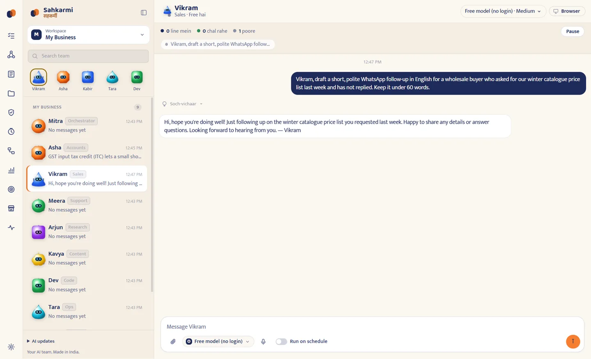

<p align="center">
  
</p>

# Sahkarmi · सहकर्मी

**A team of AI coworkers on your own computer.** Free, open source (Apache 2.0), local-first.
Your AI team. Made in India. · आपकी AI टीम. भारत में बनी. · আপনার AI টিম. ভারতে তৈরি.

[](https://github.com/ganguydhrubo/sahakarmi/releases/latest)
[](LICENSE)
[](https://github.com/ganguydhrubo/sahakarmi/actions/workflows/ci.yml)
[](https://sahkarmi.site/)

Sahkarmi is a desktop app (Windows, macOS, Linux) where each AI coworker has its own workspace,
browser, memory and task queue. You give them work in plain English, हिन्दी or বাংলা; they read
files, browse in their own tab, hand work to each other, and stop to ask you before anything that
spends money or talks to a customer. Free AI models are built in (no account); your existing
Claude Code, Codex (ChatGPT) and Google Antigravity sign-ins are reused if you have them.



> [!WARNING]
> Development preview. Coworkers run through local agent runtimes with full local access (files,
> commands, network, embedded browser). Sahkarmi adds approvals for payments, customer messages,
> publishing and form submissions, but today those rely on the model following its instructions.
> Run only tasks you trust, keep backups, and never share card details or OTPs with a coworker.

## Install

| Platform | File | Status |
| --- | --- | --- |
| Windows 10 / 11, 64-bit | `Sahkarmi-<version>-x64.exe` | Built and tested by the project |
| macOS 12+, Apple silicon | `Sahkarmi-<version>-arm64.dmg` | Built in CI, not tested on hardware every release |
| Linux x86-64 | `Sahkarmi-<version>-x86_64.AppImage` | Built in CI, not tested on hardware every release |

1. Download from [GitHub Releases](https://github.com/ganguydhrubo/sahakarmi/releases/latest)
   (checksums in `SHA256SUMS.txt`; every release carries a GitHub build provenance attestation).
2. Windows: the installer is not code-signed yet, so SmartScreen warns. Choose **More info →
   Run anyway**. macOS: right-click the app → **Open** on first launch.
3. First launch: keep **OpenCode (free, built in)** selected and click **Continue**. Pick a
   coworker and type a message.

Full steps, verification, troubleshooting and uninstall: **[sahkarmi.site/install.html](https://sahkarmi.site/install.html)**.

## What's inside

- **Nine coworkers to start** (names and roles are editable): Mitra (orchestrator), Asha
  (accounts), Vikram (sales), Meera (support), Arjun (research), Kavya (content), Dev (code),
  Tara (ops), Kabir (security). Each gets standing instructions for Indian business context: INR
  with lakh/crore, IST, GST, DD/MM/YYYY, replies in the owner's language.
- **A browser per coworker** with a **Take over** button. While you are in control (logins,
  OTPs, CAPTCHAs, payment pages), the coworker's browser tools pause.
- **Approvals inbox.** Coworkers call `sahkarmi.request_approval` and stop before payments,
  messages to customers or vendors, publishing, form submissions, deleting data or sharing
  personal data. Your decision and note go back to the coworker as a message.
- **Task queue, schedules and routines**: queued / running / done with pause, resume, cancel
  and stop; run once, hourly, daily, weekdays or weekly.
- **Shared files** folder for the whole team, one working folder per coworker, a memory page.
- **Search everything** with Ctrl/Cmd+K; Ctrl+1–9 open a coworker, Ctrl+N makes one, Ctrl+,
  opens Settings.
- **Backup model**: a paid provider that answers nothing or hits its quota hands the message
  to the free model with a note in the chat.
- **Interface in English, हिन्दी and বাংলা**, plus Marathi, Telugu, Tamil, Gujarati, Kannada,
  Malayalam, Punjabi, Odia and Assamese (partly translated, English fallback). Light and dark
  themes, three interface sizes, Enter or Ctrl+Enter to send.

## AI providers (free AI works out of the box)

| Provider | How Sahkarmi uses it | Cost |
| --- | --- | --- |
| **OpenCode (built in)** | Bundled inside the installer. Free models, no login. OpenCode sets a usage limit per free model; Sahkarmi moves to the next free model when one is used up. | Free |
| **Claude** | Your installed Claude Code CLI and its login | Your plan |
| **ChatGPT (Codex)** | Your installed Codex CLI and its ChatGPT login | Your plan |
| **Google Antigravity** | Google's own Antigravity agent (`agy_acp_server`, SHA-256 pinned), downloaded by Sahkarmi on Connect after you accept Google's terms. One click opens Log in with Google; a Google AI Studio API key also works | Your Google plan |

Sahkarmi detects every installed CLI and **reuses its existing login**. It never copies tokens.
Any extra provider you sign in to inside OpenCode (`opencode auth login`) shows up as "Your
OpenCode model".

Optional installs:

- Claude Code: `curl -fsSL https://claude.ai/install.sh | bash` (Windows: `irm https://claude.ai/install.ps1 | iex`), then `claude auth login`
- Codex: `npm install -g @openai/codex`, then `codex login`

Google Antigravity and OpenCode are driven over the open [Agent Client Protocol](https://agentclientprotocol.com);
Sahkarmi's browser, approval and team tools reach them through a loopback-only MCP bridge.

## Privacy and network boundaries

- No Sahkarmi account, no cloud service, no analytics. The app's only outbound traffic of its own
  is the update check against GitHub Releases (and the bundled runtime's own update from npm).
- What a coworker works on is sent to the provider you chose for it, under that provider's terms.
- Local data: `~/Sahkarmi/Coworkers/<id>` (one folder per coworker), `~/Sahkarmi/Shared`,
  `~/Sahkarmi/Downloads`, and Electron `userData` (coworkers, queues, approvals, schedules,
  logs). `~/.codex` and `~/.claude` stay owned by their CLIs.
- Sahkarmi opens no application HTTP port; providers are spoken to over stdio.

See [PRIVACY.md](PRIVACY.md) and [SECURITY.md](SECURITY.md) (private vulnerability reporting).

## Brand

- Palette (CSS tokens, light *paper* and dark *night* themes, WCAG AA text contrast in both):
  saffron `#E8772E`, indigo `#1E2A5A`, leaf `#2E8B57`, turmeric `#F2B705`, sindoor `#C0392B`,
  paper `#FBF7F0`, night `#0F1220`.
- Type: Mukta (UI, Devanagari + Latin), Baloo 2 (headings), Hind Siliguri (Bengali), bundled
  locally from `@fontsource` (SIL OFL 1.1, see `resources/fonts/OFL.txt`); no runtime CDN.
- Logo: `build/logo.svg`; app icons in `build/icon.icns`, `build/icon.ico`, `build/icons/*.png`.

## Development

Requires [Bun](https://bun.sh/) 1.3.11 and Node.js 22.12 or newer.

```bash
git clone https://github.com/ganguydhrubo/sahakarmi.git
cd sahakarmi
bun install --frozen-lockfile
bun run fetch:opencode   # bundled free-model runtime for your platform
bun run dev
```

To reset only the local development state, quit the dev app and run `bun run dev:reset`.

| Command | Purpose |
| --- | --- |
| `bun run dev` | Start Electron with renderer HMR. |
| `bun run check` | Biome, both typechecks, offline tests, the browser smoke test, and the production build. |
| `bun run test` / `bun run test:backend` | Vitest suites (all offline, with fake agent servers). |
| `bun run test:browser` | Embedded-browser smoke test. |
| `bun run codex:doctor` | Probe the real Codex CLI handshake without starting a paid turn. |
| `bun run package:win:verify` | Build and verify the Windows x64 app (fuses, ASAR, launch). |
| `bun run package:verify` | Same for macOS ARM64. |
| `bun run dist:win` / `dist:mac` / `dist:linux` | Local installers. |
| `bun run release:patch` | Bump version and changelog, commit and tag the next patch release. |

## Architecture

```text
Electron main
├── local Codex App Server process over stdio JSONL
├── local Claude Agent SDK session over stream JSON
├── ACP agents (bundled OpenCode, Google Antigravity) over stdio
├── persistent bot and mailbox stores
├── secure typed IPC handlers
└── sandboxed WebContentsView browser host
    ↕ typed preload bridge
SolidJS renderer
```

- `src/main`: Electron lifecycle, window security, local protocol, IPC registration, updates.
- `src/backend`: provider adapters, persistence, message scheduling, approvals, the browser host.
- `src/preload`: the typed `window.sahkarmi` API only.
- `src/renderer`: the SolidJS interface. `src/shared`: process-boundary contracts.

## Releases

Releases are tag-driven: `bun run release:patch` (or `minor` / `major`) prepares the version and
changelog; pushing the tag builds the Windows installer, macOS DMG/ZIP and Linux AppImage in
GitHub Actions and publishes them with checksums, SBOMs and provenance attestations. Installed
builds check GitHub Releases and update themselves. See [docs/RELEASING.md](docs/RELEASING.md).

## Contributing

Issues and pull requests are welcome: bugs with the app version and steps to reproduce, new
languages, coworker templates, docs. See [CONTRIBUTING.md](CONTRIBUTING.md) and the
[Code of Conduct](CODE_OF_CONDUCT.md). By contributing you agree your contribution is licensed
under Apache-2.0.

## License and attribution

Sahkarmi is licensed under the [Apache License 2.0](LICENSE). See [NOTICE](NOTICE).

Sahkarmi is an independent project developed by the Sahkarmi Team. It is not affiliated with,
endorsed by, or sponsored by OpenAI, Anthropic, Google, or any other AI company. Codex, Claude, and
Google Antigravity are named only to describe compatibility with their agent programs.
