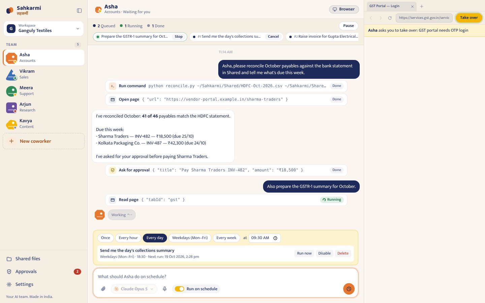
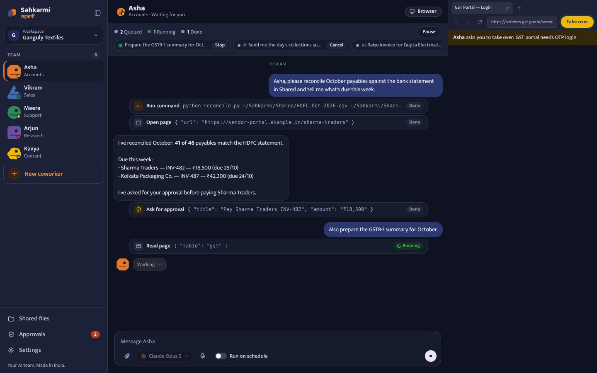
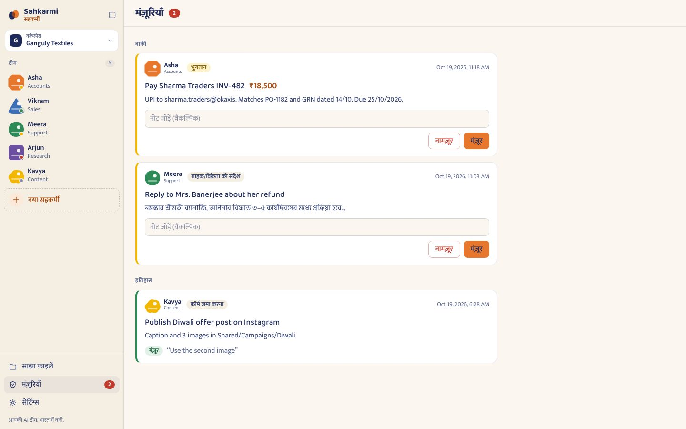
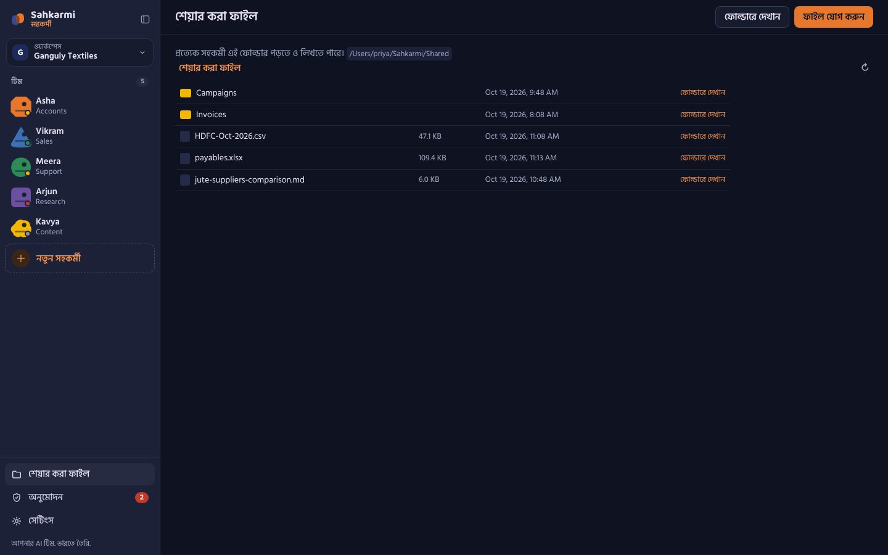

<p align="center">
  
</p>

# Sahkarmi · सहकर्मी

**AI coworkers for Indian businesses.**
Your AI team. Made in India. · आपकी AI टीम. भारत में बनी. · আপনার AI টিম. ভারতে তৈরি.

Sahkarmi is a local-first desktop app where each AI coworker has its own workspace, browser,
memory and task queue. You hire a small team (Accounts, Sales, Support, Research, Content), give
them work in plain English, हिन्दी or বাংলা, and stay in control of anything that spends money or
talks to customers.



> [!WARNING]
> Development preview. Coworkers run through your local Codex or Claude CLI with full local access
> (files, commands, network, embedded browser). Sahkarmi adds approvals for payments, customer
> messages, publishing and form submissions, but the model is ultimately trusted. Run only tasks you
> trust and keep backups.

## What's inside

**Three-pane coworker layout**

- **Left rail (260 px):** workspace switcher, the Team list (abstract avatar, name, role and a live
  status dot: idle · working · waiting for you · needs attention), *+ New coworker*,
  **Shared files**, **Approvals** (with a pending badge) and **Settings**.
- **Centre:** the selected coworker's thread: streamed replies, collapsible tool-call cards, a
  task-queue strip on top (queued / running / done with pause, resume, cancel and stop) and a composer
  with model picker, attach file, voice input (Web Speech API, en-IN / hi-IN / bn-IN) and a
  **Run on schedule** toggle (once, hourly, daily, weekdays, weekly).
- **Right pane (resizable, collapsible):** the coworker's live embedded Chromium browser with a
  **Take over** button. While you're in control (login, OTP/2FA, CAPTCHA, payment pages), coworker
  browser tools are paused. Coworkers can also *ask* you to take over, and are messaged when you
  hand back.

**Default team** (names and roles are editable): Asha (Accounts), Vikram (Sales), Meera (Support),
Arjun (Research), Kavya (Content). Each coworker gets standing instructions for Indian business
context: INR with lakh/crore, IST, GST, DD/MM/YYYY, and replies in the owner's language.

**Approvals.** Coworkers must call `sahkarmi.request_approval` and stop before payments, messages to
customers or vendors, publishing, government/bank/marketplace form submissions, deleting data or
sharing personal data. Your decision and note are delivered back to the coworker as a message, so
nothing blocks while you are away.

| Dark theme | Approvals (हिन्दी) | Shared files (বাংলা) |
| --- | --- | --- |
|  |  |  |

## Brand

- Palette (CSS tokens, light *paper* and dark *night* themes, WCAG AA text contrast in both):
  saffron `#E8772E` (primary fill), indigo `#1E2A5A`, leaf `#2E8B57`, turmeric `#F2B705`,
  sindoor `#C0392B`, paper `#FBF7F0`, night `#0F1220`. Saffron is used as a fill; saffron-coloured
  text uses a darker ink (`#A84E14` light / `#F0904F` dark) to stay above 4.5:1.
- Type: Mukta (UI, Devanagari + Latin), Baloo 2 (headings), Hind Siliguri (Bengali), all bundled
  locally from `@fontsource` (SIL OFL 1.1, see `resources/fonts/OFL.txt`); no runtime CDN.
- Logo: `build/logo.svg`; app icons in `build/icon.icns`, `build/icon.ico` and `build/icons/*.png`
  (16–1024 px).

## AI providers (free AI works out of the box)

| Provider | How Sahkarmi uses it | Cost |
| --- | --- | --- |
| **OpenCode (built in)** | Bundled inside the installer, nothing to install. Free models, no login. | Free |
| **Gemini** | Your installed Gemini CLI and its Google sign-in, API key or Vertex AI | Free tier |
| **Claude** | Your installed Claude Code CLI and its login | Your plan |
| **ChatGPT (Codex)** | Your installed Codex CLI and its ChatGPT login | Your plan |

Sahkarmi detects every installed CLI and **reuses its existing login**. It never copies tokens. Any
extra provider you sign in to inside OpenCode (`opencode auth login`: API keys, Copilot and more)
shows up as "Your OpenCode model".

Optional installs:

- Claude Code: `curl -fsSL https://claude.ai/install.sh | bash` (Windows: `irm https://claude.ai/install.ps1 | iex`), then `claude auth login`
- Codex: `npm install -g @openai/codex`, then `codex login`
- Gemini CLI: `npm install -g @google/gemini-cli`, then run `gemini` once and sign in with Google

Gemini CLI and OpenCode are driven over the open [Agent Client Protocol](https://agentclientprotocol.com);
Sahkarmi's browser, approval and team tools reach them through a loopback-only MCP bridge.

## Development

Development requires [Bun](https://bun.sh/) 1.3.11, Node.js 22.12 or newer, and at least one
supported agent CLI.

```bash
git clone https://github.com/ganguydhrubo/sahakarmi.git
cd sahakarmi
bun install --frozen-lockfile
bun run codex:doctor
bun run dev
```

`codex:doctor` checks the CLI version, App Server handshake, ChatGPT login, and Computer Use plugin
without starting a model turn.

To reset only the local development state, quit the dev app and run `bun run dev:reset`. The command
deletes the development state. It does not change agent workspaces or CLI sessions.

## Commands

| Command | Purpose |
| --- | --- |
| `bun run dev` | Start Electron with renderer HMR. |
| `bun run dev:reset` | Delete the local development state. |
| `bun run check` | Run Biome, both typechecks, offline tests, the browser smoke test, and the production build. |
| `bun run test:backend` | Run backend tests only. |
| `bun run test:browser` | Run the local embedded-browser smoke test. |
| `bun run test:codex` | Probe the real CLI handshake and account without starting a paid turn. |
| `bun run package` | Build an unpacked local ARM64 application. |
| `bun run package:verify` | Build and verify the real ARM64 app bundle, icon, metadata, ASAR, and fuses. |
| `bun run package:win` | Build an unpacked local Windows x64 application on Windows. |
| `bun run package:win:verify` | Build and verify the Windows x64 application on Windows. |
| `bun run release:preflight` | Verify version, Git state, Apple signing, and GitHub release secrets before tagging. |
| `bun run dist:mac` | Build unsigned local ARM64 DMG and ZIP update artifacts. |
| `bun run dist:win` | Build an unsigned Windows x64 NSIS installer on Windows. |
| `bun run release:patch` | Create the next patch version commit and tag. |
| `bun run test:filesystem` | **Online/manual:** run a real full-access Codex filesystem turn. |
| `bun run test:imagegen` | **Online/manual:** run a real full-access image-generation turn. |

The normal `check` command is offline and uses a fake App Server. Manual smoke scripts may use the
signed-in subscription and must not run in CI.

## Architecture

```text
Electron main
├── local Codex App Server process over stdio JSONL
├── local Claude Agent SDK session over stream JSON
├── persistent bot and mailbox stores
├── secure typed IPC handlers
└── sandboxed WebContentsView browser host
    ↕ typed preload bridge
SolidJS renderer
```

- `src/main` owns the Electron lifecycle, window security, local protocol, and IPC registration.
- `src/backend` owns provider adapters, persistence, message scheduling, transfers, and the browser host.
- `src/preload` exposes only the typed `window.sahkarmi` API.
- `src/renderer` contains the SolidJS interface.
- `src/shared` contains process-boundary contracts.

## Local data and network boundaries

- `~/Sahkarmi/Coworkers/<coworker-id>` — one working directory (and memory) per coworker.
- `~/Sahkarmi/Shared` — the Shared files folder every coworker and you can see.
- `~/Sahkarmi/Downloads` — embedded-browser downloads.
- Electron `userData` — coworkers, workspaces, queues, approvals, schedules, drafts, and attachment indexes.
- `~/.codex` — login and thread history managed exclusively by Codex CLI.
- `~/.claude` — login and session history managed exclusively by Claude CLI.

Sahkarmi does not open an application HTTP port. Electron communicates with local CLI processes over
stdio. The embedded browser uses a separate sandboxed Electron session and cannot access
`window.sahkarmi` or managed local attachments.

## Security

Read [SECURITY.md](SECURITY.md) before reporting a vulnerability. Do not put credentials, private
files, conversation contents, or sensitive diagnostics in a public issue.

Full local access is an explicit current product decision, not a security boundary. Reports are
especially useful when remote content can reach Electron privileges, managed attachment paths can
escape their roots, IPC sender validation can be bypassed, or an agent can act outside the access
described above.

## Releases

Releases are tag-driven. `bun run release:patch`, `release:minor`, or `release:major` prepares the
version and changelog. After review, commit, preflight, and tag the release; pushing the tag builds a
signed and notarized macOS ARM64 release and an unsigned Windows x64 release in GitHub Actions.
Installed builds check GitHub Releases for updates and expose download/restart controls in the account
popover. Release signing secrets and the complete procedure are documented in
[docs/RELEASING.md](docs/RELEASING.md).

## Contributing

See [CONTRIBUTING.md](CONTRIBUTING.md). By contributing, you agree that your contribution is licensed
under Apache-2.0. Community behavior is governed by the [Code of Conduct](CODE_OF_CONDUCT.md).

## License and attribution

Sahkarmi is licensed under the [Apache License 2.0](LICENSE). See [NOTICE](NOTICE).

Sahkarmi is an independent project developed by the Sahkarmi Team. It is not affiliated with, endorsed by, or sponsored by
OpenAI, Anthropic, Google, or any other AI company. Codex, Claude, and Gemini are named only to describe
compatibility with their CLIs.
