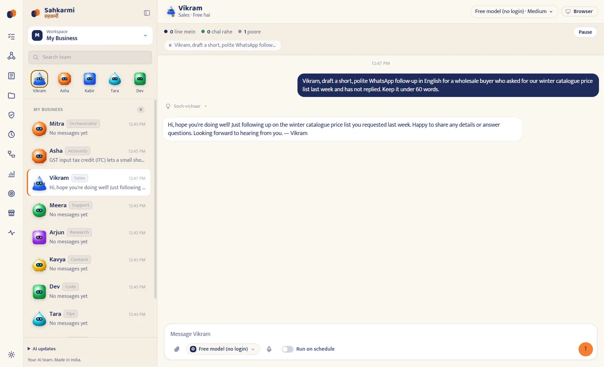

<p align="center">
  
</p>

<h1 align="center">Sahkarmi · सहकर्मी</h1>

<p align="center">
  <strong>Free, open-source AI coworkers that do the work on your own Windows PC.</strong><br />
  They browse websites, use desktop apps and work with your files, and they ask you before anything is posted, sent or paid.
</p>

<p align="center">Your AI team. Made in India. · आपकी AI टीम. भारत में बनी. · আপনার AI টিম. ভারতে তৈরি.</p>

<p align="center">
  <a href="https://github.com/ganguydhrubo/sahakarmi/releases/latest"></a>
  <a href="https://github.com/ganguydhrubo/sahakarmi/releases"></a>
  <a href="LICENSE"></a>
  <a href="https://github.com/ganguydhrubo/sahakarmi/actions/workflows/ci.yml"></a>
  <a href="https://github.com/ganguydhrubo/sahakarmi/stargazers"></a>
</p>

<p align="center">
  <a href="https://github.com/ganguydhrubo/sahakarmi/releases/latest"><strong>Download for Windows »</strong></a>
  <br />
  <br />
  <a href="https://apps.microsoft.com/detail/9PD6BP3NGVST">Microsoft Store</a>
  ·
  <a href="https://sahkarmi.site/">Website</a>
  ·
  <a href="https://sahkarmi.site/videos/">Videos</a>
  ·
  <a href="https://sahkarmi.site/coworkers/">175 coworkers</a>
  ·
  <a href="https://sahkarmi.site/install.html">Install guide</a>
  ·
  <a href="CHANGELOG.md">Changelog</a>
</p>

<p align="center">
  <a href="https://sahkarmi.site/videos/"></a>
</p>

## What a coworker can do

You give work in plain English, हिन्दी or বাংলা. Each coworker has its own workspace, browser,
memory and task queue, and they hand work to each other.

- 🖥️ **Use your PC**: open apps, click, type and read windows, with the *Control this PC* permission.
- 🌐 **Use websites** in its own browser. You press **Take over** for logins, OTPs and payments.
- 📁 **Work with your files** and answer from your own documents, with the page cited.
- ✋ **Ask first**: payments, messages to customers, publishing and deleting wait for your OK.
- 🔁 **Run routines** on a schedule, such as a weekly GST check or daily lead follow-up.
- 📱 **Reach you anywhere**: approve and chat from your phone or Telegram.
- 🆓 **Free out of the box**: free AI models are built in, with no account. Claude, ChatGPT
  (Codex) and Google Gemini (Antigravity) connect when you want them.

## Install

| Platform | File | Status |
| --- | --- | --- |
| Windows 10 / 11, 64-bit | `Sahkarmi-<version>-x64.exe` | Built and tested by the project |
| macOS, Linux | none yet | Paused until tested on real hardware; build from source meanwhile |

1. Download from [GitHub Releases](https://github.com/ganguydhrubo/sahakarmi/releases/latest)
   (checksums in `SHA256SUMS.txt`; every release carries a GitHub build provenance attestation),
   or install from the [Microsoft Store](https://apps.microsoft.com/detail/9PD6BP3NGVST).
2. The installer from GitHub is not code-signed yet, so SmartScreen warns. Choose **More info →
   Run anyway**.
3. First launch: keep **OpenCode (free, built in)** selected and click **Continue**. Pick a
   coworker and type a message.

With [Scoop](https://scoop.sh/):

```powershell
scoop bucket add sahkarmi https://github.com/ganguydhrubo/scoop-sahkarmi; scoop install sahkarmi
```

Full steps, verification, troubleshooting and uninstall: **[sahkarmi.site/install.html](https://sahkarmi.site/install.html)**.

> [!WARNING]
> Development preview. Coworkers run through local agent runtimes with full local access (files,
> commands, network, embedded browser). Since 0.24.0 every shell command goes through the
> approval rules in the app. Stopping before a payment, a customer message, publishing or a form
> submission inside a web page still relies on the model following its instructions. Run only
> tasks you trust, keep backups, and never share card details or OTPs with a coworker.

## What's inside

**Your team**

- **Nine coworkers to start** (names and roles are editable): Mitra (orchestrator), Asha
  (accounts), Vikram (sales), Meera (support), Arjun (research), Kavya (content), Dev (code),
  Tara (ops), Kabir (security). Each gets standing instructions for Indian business context: INR
  with lakh/crore, IST, GST, DD/MM/YYYY, replies in the owner's language.
- **A marketplace of 175 ready-made coworkers**: accountant, HR manager, shop manager, tutor,
  designer, developer and many more. [See them all](https://sahkarmi.site/coworkers/).
- **Team runs**: one job split across several coworkers. A run pauses when it needs your
  approval and resumes from the last finished step, even after the app was closed.

**Doing the work**

- **Desktop control (Windows, 0.22.0+)**: with the *Control this PC* permission a coworker can
  take screenshots, start and focus apps, read a window's controls through UI Automation, click,
  scroll, drag, type and press keys. One coworker drives the desktop at a time; typing into
  password fields and Windows credential prompts is refused.
- **A browser per coworker** with a **Take over** button. While you are in control (logins,
  OTPs, CAPTCHAs, payment pages), the coworker's browser tools pause.
- **Knowledge Bases**: your PDFs, Word, Excel, PowerPoint and text files indexed on this
  computer (SQLite full-text search, nothing uploaded); coworkers answer from them and cite the
  page, slide or sheet as [S1]. Optional "smarter search": one 30 MB embedding model (MIT),
  downloaded once, matches by meaning in plain JavaScript on this computer.
- **Apps you already use**: Gmail, Sheets, Slack, Notion, GitHub, HubSpot and 1,600+ more
  through Composio's free plan. Anything that sends, changes or deletes waits for your OK.
- **Skills and MCP servers**: paste the MCP JSON from any README or `.mcp.json`, or load skills
  from a GitHub repo.
- **Shared files** folder for the whole team, one working folder per coworker, a memory page.

**Staying in charge**

- **Approvals inbox.** Coworkers call `sahkarmi.request_approval` and stop before payments,
  messages to customers or vendors, publishing, form submissions, deleting data or sharing
  personal data. Your decision and note go back to the coworker as a message.
- **Phone & Host (0.33.0+)**: approve requests, chat and run routines from your iPhone or
  Android phone, through your own Tailscale. Only devices you pair can open it.
- **Telegram**: new approvals are announced in the one chat you paired, and you can message a
  coworker from there. A coworker that needs an OTP or login ID can ask you in Telegram; your
  reply is typed into the page and deleted from the chat.

**Automation**

- **Task queue, schedules and routines**: queued / running / done with pause, resume, cancel
  and stop; run once, hourly, daily, weekdays or weekly.
- **Routines with steps**: coworker task, yes/no check, ask me first, send the result. Describe
  a routine in your own words and the orchestrator drafts it, or start from ten ready-made ones
  for small businesses. **Rerun from here** repeats one step without redoing the earlier ones.
- **Backup model**: a paid provider that answers nothing or hits its quota hands the message
  to the free model with a note in the chat.

**Made for you**

- **Voice**: dictation that works offline after a one-time model download, covering all 22
  scheduled Indian languages, Hinglish and English, plus spoken replies in Indian and English
  voices.
- **Interface in English, हिन्दी and বাংলা**, plus Marathi, Telugu, Tamil, Gujarati, Kannada,
  Malayalam, Punjabi, Odia and Assamese (partly translated, English fallback). Light and dark
  themes, three interface sizes, Enter or Ctrl+Enter to send.
- **Search everything** with Ctrl/Cmd+K; Ctrl+1–9 open a coworker, Ctrl+N makes one, Ctrl+,
  opens Settings.

## AI providers (free AI works out of the box)

| Provider | How Sahkarmi uses it | Cost |
| --- | --- | --- |
| **OpenCode (built in)** | Bundled inside the installer. Free models, no login. OpenCode sets a usage limit per free model; Sahkarmi moves to the next free model when one is used up. | Free |
| **Claude** | The Claude CLI with Sahkarmi's own sign-in (Settings → AI and models → Connect). Since 0.22.0 it is kept separate from your Claude Code account. | Your plan |
| **ChatGPT (Codex)** | Your installed Codex CLI and its ChatGPT login | Your plan |
| **Google Antigravity** | Google's own Antigravity agent (`agy_acp_server`, SHA-256 pinned), downloaded by Sahkarmi on Connect after you accept Google's terms. One click opens Log in with Google; a Google AI Studio API key also works | Your Google plan |

Sahkarmi detects every installed CLI and reuses its existing login (Claude excepted: it has its own, see above). It never copies tokens.
Any extra provider you sign in to inside OpenCode (`opencode auth login`) shows up as "Your
OpenCode model".

Optional installs:

- Claude Code: `curl -fsSL https://claude.ai/install.sh | bash` (Windows: `irm https://claude.ai/install.ps1 | iex`), then `claude auth login`
- Codex: `npm install -g @openai/codex`, then `codex login`

Google Antigravity and OpenCode are driven over the open [Agent Client Protocol](https://agentclientprotocol.com);
Sahkarmi's browser, approval and team tools reach them through a loopback-only MCP bridge.

## Privacy and network boundaries

- No Sahkarmi account, no cloud service and no analytics. From 0.26.0 the app asks once whether
  it may add this PC to an anonymous daily user count; nothing is sent unless you say yes, and
  you can change it in Settings → About.
- What a coworker works on is sent to the provider you chose for it, under that provider's terms.
  Telegram, Composio and Tailscale are used only if you connect them.
- The app also checks GitHub Releases for updates (and the bundled runtime updates itself from npm).
- Local data: `%USERPROFILE%\Sahkarmi` (one folder per coworker, Shared files and Downloads) and
  `%APPDATA%\Sahkarmi` (coworkers, chats, queues, approvals, schedules, the browser profile,
  logs). `~/.codex` and `~/.claude` stay owned by their CLIs.
- Sahkarmi's local servers listen on this PC only (127.0.0.1). Phone access comes in through
  your own Tailscale, never a public port.

Full policy: [sahkarmi.site/privacy.html](https://sahkarmi.site/privacy.html). Vulnerabilities:
[SECURITY.md](SECURITY.md) (private reporting).

## Development

Requires [Bun](https://bun.sh/) 1.3.11 and Node.js 22.12 or newer.

```bash
git clone https://github.com/ganguydhrubo/sahakarmi.git
cd sahakarmi
bun install --frozen-lockfile
bun run fetch:opencode   # bundled free-model runtime for your platform
bun run dev
```

To reset only the local development state, quit the dev app and run `bun run dev:reset`.

| Command | Purpose |
| --- | --- |
| `bun run dev` | Start Electron with renderer HMR. |
| `bun run check` | Biome, both typechecks, offline tests, the browser smoke test, and the production build. |
| `bun run test` / `bun run test:backend` | Vitest suites (all offline, with fake agent servers). |
| `bun run test:browser` | Embedded-browser smoke test. |
| `bun run codex:doctor` | Probe the real Codex CLI handshake without starting a paid turn. |
| `bun run package:win:verify` | Build and verify the Windows x64 app (fuses, ASAR, launch). |
| `bun run package:verify` | Same for macOS ARM64. |
| `bun run dist:win` / `dist:mac` / `dist:linux` | Local installers. |
| `bun run release:patch` | Bump version and changelog, commit and tag the next patch release. |

## Architecture

```text
Electron main
├── local Codex App Server process over stdio JSONL
├── local Claude Agent SDK session over stream JSON
├── ACP agents (bundled OpenCode, Google Antigravity) over stdio
├── persistent bot and mailbox stores
├── secure typed IPC handlers
└── sandboxed WebContentsView browser host
    ↕ typed preload bridge
SolidJS renderer
```

- `src/main`: Electron lifecycle, window security, local protocol, IPC registration, updates.
- `src/backend`: provider adapters, persistence, message scheduling, approvals, the browser host.
- `src/preload`: the typed `window.sahkarmi` API only.
- `src/renderer`: the SolidJS interface. `src/shared`: process-boundary contracts.

## Releases

Releases are tag-driven: `bun run release:patch` (or `minor` / `major`) prepares the version and
changelog; pushing the tag builds the Windows installer in GitHub Actions and publishes it with
checksums, SBOM and provenance attestation. The macOS and Linux jobs are paused; set the repository
variable `RELEASE_ALL_PLATFORMS` to `true` to build them again. Installed
builds check GitHub Releases and update themselves. See [docs/RELEASING.md](docs/RELEASING.md).

## Brand

- Palette (CSS tokens, light *paper* and dark *night* themes, WCAG AA text contrast in both):
  saffron `#E8772E`, indigo `#1E2A5A`, leaf `#2E8B57`, turmeric `#F2B705`, sindoor `#C0392B`,
  paper `#FBF7F0`, night `#0F1220`.
- Type: Mukta (UI, Devanagari + Latin), Baloo 2 (headings), Hind Siliguri (Bengali), bundled
  locally from `@fontsource` (SIL OFL 1.1, see `resources/fonts/OFL.txt`); no runtime CDN.
- Logo: `build/logo.svg`; app icons in `build/icon.icns`, `build/icon.ico`, `build/icons/*.png`.

## Community

- Watch real jobs being done: [video library](https://sahkarmi.site/videos/) and
  [YouTube](https://www.youtube.com/@sahkarmiai).
- Follow along on [Instagram](https://www.instagram.com/sahkarmiai) and
  [LinkedIn](https://www.linkedin.com/company/sahkarmi/).
- Found a bug or want a feature? [Open an issue](https://github.com/ganguydhrubo/sahakarmi/issues)
  with your app version and the steps.

If Sahkarmi saves you a few hours, a ⭐ helps other people find it.

## Contributing

Issues and pull requests are welcome: bugs with the app version and steps to reproduce, new
languages, coworker templates, docs. See [CONTRIBUTING.md](CONTRIBUTING.md) and the
[Code of Conduct](CODE_OF_CONDUCT.md). By contributing you agree your contribution is licensed
under Apache-2.0.

## License and attribution

Sahkarmi is licensed under the [Apache License 2.0](LICENSE). See [NOTICE](NOTICE).

Sahkarmi is an independent project developed by the Sahkarmi Team. It is not affiliated with,
endorsed by, or sponsored by OpenAI, Anthropic, Google, or any other AI company. Codex, Claude, and
Google Antigravity are named only to describe compatibility with their agent programs.
